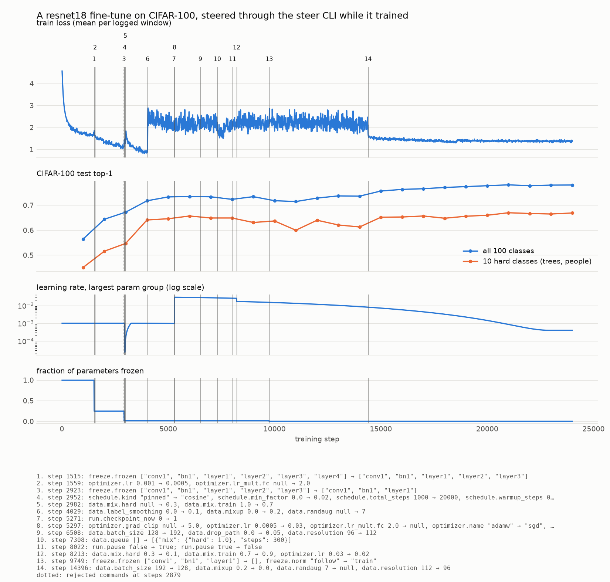

# steerable-timm

The hook structure that lets an LLM steer a [timm](https://github.com/huggingface/pytorch-image-models) training run while it trains.

- The run has one typed, versioned `State` document: optimizer, schedule, freezing, data, run control.
- Anyone changes it by appending a JSON patch to a SQLite file in the run directory. Writers never talk to the trainer.
- The loop calls `steer.sync(step)` once per step. It reads one integer; if patches are pending it validates them, applies them as one change, and calls the hooks registered for the paths that changed.
- Hooks turn the change into an action on the live objects: edit the optimizer, rebuild param groups, swap a DataLoader, pause.
- Every applied or rejected change and every metrics row lands in one `events` table on the same step axis.

It is not a fork of timm and does not patch timm's `train.py`. timm supplies models, optimizers, schedulers and augmentation; [Lightning Fabric](https://lightning.ai/docs/fabric/stable/) supplies devices, DDP and AMP; the loop is yours (`examples/train.py` is about 100 lines).

## Quickstart

```sh
git clone https://github.com/GeorgePearse/steerable-timm && cd steerable-timm
uv sync

# terminal 1: head-only fine-tune of a pretrained resnet18 on CIFAR-100
uv run python examples/train.py --run runs/demo --steer --steps 10000 \
    --set optimizer.lr=1e-3 --set 'freeze.frozen=["conv1","bn1","layer1","layer2","layer3","layer4"]'

# terminal 2: a person, or any agent with a shell
export STEER_RUN=runs/demo
uv run steer schema                                    # every field, type, bounds
uv run steer metrics --last 20                         # compact rows: step loss lr grad_norm frozen samples/s source
uv run steer unfreeze layer4 --why "head has plateaued"
uv run steer set optimizer.lr=3e-4 schedule.kind=cosine schedule.total_steps=5000 --why "..."
uv run steer set optimizer.name=sgd optimizer.lr=0.02
uv run steer data mix train=0.7 hard=0.3
uv run steer data queue hard:200                       # source "hard" for 200 steps, then back to the mix
uv run steer set data.randaug=9 data.mixup=0.2 data.batch_size=256
uv run steer run eval                                  # also: pause, resume, checkpoint, stop
uv run steer log --last 20                             # what was applied or rejected, at which step, and why
```

`steer set` prints the verdict: `#7 applied at step 4120`, or `#8 rejected optimizer.lr: Input should be less than or equal to 10`.

The same from Python:

```python
from steerable_timm import CommandLog

run = CommandLog("runs/demo")
command = run.set(
    {"optimizer.lr": 3e-4, "freeze.frozen-": ["layer4"]}, why="head has plateaued", author="my-agent"
)
run.wait(command)  # {'id': 7, 'status': 'applied', 'step': 4120, 'error': None}
run.get()  # current State as a dict
run.metrics(last=200)  # metrics rows
run.log(last=20)  # change rows
```

A patch maps dotted paths to values. A trailing `+` or `-` on a list path adds or removes items, so two writers freezing different layers do not overwrite each other.

## In your loop

```python
from steerable_timm import CommandLog, Live, State, Steer, builtin, due, set_lr

live = Live(fabric, module, sources={"train": make_train_dataset}, num_classes=100)
builtin.apply(live, None, state, 0)  # builds model wrapper, optimizer, schedule, loaders from State
steer = Steer(CommandLog(run_dir), live, state, builtin)

for step in range(steps):
    state = steer.sync(step)  # the only call that reads the command log
    if state.run.stop:
        break
    set_lr(live, state, step)
    source, (x, y) = live.feeder.next(step)
    loss = F.cross_entropy(live.model(x), y, label_smoothing=state.data.label_smoothing)
    fabric.backward(loss)
    live.stepper.step()
    live.optimizer.zero_grad()
    steer.metrics(step + 1, loss=loss.item(), source=source)
```

A data source is a function from the `data` section of the State to a `Dataset`, so resolution and augmentation changes reach it. Without `--steer` the example builds the same objects from the same State and never calls `sync`; a test checks the two runs give identical losses at a fixed seed.

## Hooks

| State path | What the built-in hook does | When |
|---|---|---|
| `optimizer.weight_decay`, `betas`, `momentum` | edits the param groups in place | at the step it is applied |
| `optimizer.lr` | `set_lr` writes `lr × group multiplier × schedule factor` into every group | every step |
| `optimizer.name`, `optimizer.lr_mult` | new optimizer from `timm.optim.create_optimizer_v2` over rebuilt param groups | at the step it is applied |
| `freeze.frozen`, `freeze.norm` | `requires_grad` by name pattern, batch-norm train/eval mode, param groups rebuilt, DDP wrapper rebuilt | at the step it is applied |
| `schedule.*` | new `timm.scheduler` whose output is used as a factor on `optimizer.lr` | at the step it is applied |
| `data.mix`, `data.queue` | changes the per-step draw of which source the batch comes from | next batch, if the sources are already loaded |
| `data.batch_size`, `resolution`, `randaug`, `workers`, a new source | new DataLoaders built in a background thread, first batch prefetched | switched at a step boundary once ready |
| `data.mixup`, `data.cutmix` | new `timm.data.Mixup` | next batch |
| `data.drop_path` | sets `drop_prob` on the model's `DropPath` modules, scaled linearly with depth | next batch |
| `data.label_smoothing`, `data.accumulation`, `optimizer.grad_clip` | no hook: the loop reads them from State | next batch |
| `run.pause`, `run.stop` | `sync` holds at the step boundary until unpaused; the loop breaks on stop | at the step it is applied |
| `run.eval_now`, `checkpoint_now`, `eval_every`, `checkpoint_every` | `due(live, state, step)` tells the loop what to do after this step | after the step |

What resets when the optimizer is rebuilt:

- Same optimizer type (a freeze or `lr_mult` change): per-parameter state (momentum, Adam moments and step count) is kept for every parameter that is still trainable. Newly unfrozen parameters start with fresh state.
- Different optimizer type: all optimizer state is dropped.
- Either way, gradients accumulated so far in an unfinished accumulation window are discarded.

A schedule's clock starts at the step it is applied unless `schedule.origin` pins it. Changing `optimizer.lr` under a running schedule rescales it without restarting it.

Patterns match parameter names. `layer4` and `blocks.[0-5]` cover everything under them, `*.bias` is a glob, `re:` prefixes a regular expression.

Under DDP, rank 0 reads the log and broadcasts the new State, so every rank applies the same version at the same step. The source drawn for each step is seeded by the step, and a loader switch waits until every rank has built its loaders.

Patches are validated in order against the schema and the checks (unknown optimizer, unknown data source, nothing left trainable). Invalid ones are rejected individually with the reason; the valid ones are coalesced into one new version and one pass over the hooks. If a hook raises, the previous State is re-applied and the batch is recorded as rejected.

### Writing a hook

```python
from steerable_timm import builtin

hooks = builtin.copy()


@hooks.on_change("extra.aux_weight")
def aux_weight(live, old, new, step):
    live.aux_weight = float(new.extra.get("aux_weight", 0.4))


@hooks.check
def aux_weight_bounds(live, state):
    if not 0 <= state.extra.get("aux_weight", 0.4) <= 2:
        raise ValueError("extra.aux_weight must be in [0, 2]")


steer = Steer(CommandLog(run_dir), live, state, hooks)
```

`steer set extra.aux_weight=0.8 --why "..."` now reaches it. A hook receives the live objects, the old and new State and the step. `extra` is a free-form section for your own fields; a hook can also watch any built-in path.

## State schema

Output of `steer schema`:

| Path | Type | Bounds | Default | Notes |
|---|---|---|---|---|
| `optimizer.name` | `str` |  | `'adamw'` | timm optimizer name; a change rebuilds the optimizer |
| `optimizer.lr` | `float` | &gt; 0 ≤ 10 | `0.001` | base lr, before lr_mult and the schedule factor |
| `optimizer.weight_decay` | `float` | ≥ 0 ≤ 1 | `0.05` | not applied to biases and 1-d params |
| `optimizer.betas` | `tuple[float, float] \| None` |  | `None` | only for optimizers that have betas |
| `optimizer.momentum` | `float` | ≥ 0 &lt; 1 | `0.9` | only for optimizers that have momentum |
| `optimizer.grad_clip` | `float \| None` | &gt; 0 | `None` | max grad norm; null disables clipping |
| `optimizer.lr_mult` | `dict[str, float]` |  | `{}` | param-name pattern -> lr multiplier; first match wins |
| `schedule.kind` | `Literal['pinned', 'cosine', 'tanh', 'step', 'poly']` |  | `'pinned'` | pinned = lr stays at optimizer.lr; else a timm scheduler shapes a factor |
| `schedule.total_steps` | `int` | ≥ 1 | `1000` | length of the schedule in steps |
| `schedule.warmup_steps` | `int` | ≥ 0 | `0` |  |
| `schedule.min_factor` | `float` | ≥ 0 ≤ 1 | `0.0` | floor of the factor multiplying optimizer.lr |
| `schedule.decay_steps` | `int` | ≥ 1 | `100` | step schedule: steps between decays |
| `schedule.decay_rate` | `float` | &gt; 0 ≤ 1 | `0.1` | step schedule: factor per decay |
| `schedule.origin` | `int \| None` | ≥ 0 | `None` | step where t=0; null = the step it was applied |
| `freeze.frozen` | `list[str]` |  | `[]` | param-name patterns that do not train |
| `freeze.norm` | `Literal['follow', 'train', 'eval']` |  | `'follow'` | batch-norm mode: follow = eval when all its params are frozen |
| `data.mix` | `dict[str, float]` |  | `{'train': 1.0}` | source name -> weight; each batch is one source |
| `data.queue` | `list[Stage]` |  | `[]` | stages of {mix, steps} run in order before mix resumes |
| `data.batch_size` | `int` | ≥ 1 ≤ 4096 | `64` |  |
| `data.accumulation` | `int` | ≥ 1 ≤ 64 | `1` | batches per optimizer step |
| `data.resolution` | `int` | ≥ 16 ≤ 1024 | `224` |  |
| `data.mixup` | `float` | ≥ 0 ≤ 2 | `0.0` | mixup alpha |
| `data.cutmix` | `float` | ≥ 0 ≤ 2 | `0.0` | cutmix alpha |
| `data.randaug` | `int \| None` | ≥ 0 ≤ 30 | `None` | RandAugment magnitude; null = off |
| `data.label_smoothing` | `float` | ≥ 0 ≤ 0.5 | `0.0` |  |
| `data.drop_path` | `float` | ≥ 0 ≤ 0.9 | `0.0` | max stochastic-depth rate |
| `data.workers` | `int` | ≥ 0 ≤ 64 | `4` |  |
| `run.pause` | `bool` |  | `False` | hold at the next step boundary until false |
| `run.stop` | `bool` |  | `False` | end the run at the next step boundary |
| `run.eval_every` | `int` | ≥ 0 | `0` | steps between evals; 0 = never |
| `run.checkpoint_every` | `int` | ≥ 0 | `0` | steps between checkpoints; 0 = never |
| `run.eval_now` | `int` | ≥ 0 | `0` | change the value to request one eval |
| `run.checkpoint_now` | `int` | ≥ 0 | `0` | change the value to request one checkpoint |

`version` is set by the trainer and goes up by one per applied change. Checkpoints written by the example store the whole State, including the version, and `--resume` restores it.

## Tracking

Everything is in `steer.db` in the run directory. `events.kind` is `metrics`, `eval`, `change`, `state`, `note`; `data` is JSON.

```sql
SELECT step, kind, version, data FROM events WHERE kind IN ('metrics', 'eval', 'change') ORDER BY step, id;
```

Metrics rows are buffered and written every 10 rows, and whenever a change is applied. A metrics row has loss, lr per param group, grad norm, frozen fraction, samples/s and the active data source. A change row has the command id, author, reason, patch, diff and applied/rejected with the error.

## Overhead

`python bench/overhead.py`: a small CPU training step (timm `test_resnet`, batch 8) while another process appends patches at a fixed rate. Measured on a busy shared 16-core machine, so read the ratios, not the absolute times.

| writes/s | step ms | sync mean µs | sync median µs | sync p99 µs | patches applied | versions |
|---|---|---|---|---|---|---|
| 0 | 15.2 | 27 | 27 | 40 | 0 | 0 |
| 10 | 13.1 | 120 | 23 | 867 | 58 | 54 |
| 100 | 13.8 | 809 | 650 | 10448 | 603 | 400 |
| 1000 | 16.0 | 2798 | 2291 | 9671 | 6895 | 400 |

400 steps per row.

With nothing pending, `sync` is one `SELECT max(id)`: about 8 µs when called back to back, 27 to 40 µs in a real loop where the training step has evicted it from cache. Under load the cost is validating and recording the patches; however many arrive between two steps, they become one new version and one pass over the hooks.

## Demo

A pretrained `resnet18.a1_in1k` fine-tuned on CIFAR-100 for 24,000 steps on one T4 (`demo/modal_app.py`). The training process started head-only and only ever read `steer.db`. Every change below was made by an LLM (Claude) running the `steer` CLI in a separate process in the same container while the run trained, reading `steer metrics` first and giving its reason with `--why`.

This shows that steering works: each change took effect at a known step and is on the record next to the metrics. It is not a claim that the run trained better than a fixed recipe would have. There is no baseline here, and one of the changes (300 steps on the hard classes alone) was followed by a dip in accuracy. Final test top-1 was 0.781.



`steer log`, with the reasons shortened:

| Step | Change | Reason given |
|---|---|---|
| 1515 | unfreeze `layer4` (frozen params 99.5% → 24.8%) | head-only loss had flattened |
| 1559 | `optimizer.lr` 1e-3 → 5e-4, `lr_mult.fc` = 2 | a pretrained stage is now training |
| 2879 | **rejected**: `data.mix` with source `difficult` | `unknown source ['difficult']; have ['hard', 'train']` |
| 2923 | unfreeze `layer3`, `layer2` (frozen → 1.4%) | layer4 adapted without instability |
| 2952 | `schedule` pinned → cosine, 20,000 steps, 300 warmup | warm up the newly unfrozen stages, then decay |
| 2982 | `data.mix` train 0.7, hard 0.3; new loader in at step 2996 | hard classes trail overall top-1 |
| 4029 | RandAugment 7, mixup 0.2, label smoothing 0.1; new loaders in at step 4055 | train loss falling much faster than test top-1 rises |
| 5271 | checkpoint now | snapshot before changing the optimizer |
| 5297 | AdamW → SGD, lr 0.03, momentum 0.9, grad clip 5 | moment buffers reset, cosine clock keeps running |
| 6508 | resolution 96 → 112, batch 128 → 192, drop path 0.05; new loaders in at step 6540 | try larger crops and batch |
| 7308 | queue: source `hard` for 300 steps | top-1 on hard classes flat near 0.65 |
| 8022 | pause, then resume (held about 12 s) | read the evals |
| 8213 | `data.mix` train 0.9, hard 0.1; `optimizer.lr` 0.03 → 0.02 | the hard-only stage did not help and overall top-1 dipped |
| 9749 | unfreeze everything, batch-norm in train mode | plateau with the stem and layer1 frozen |
| 14396 | mixup and RandAugment off, back to 96 px and batch 128; new loaders in at step 14409 | flat under heavy regularisation at a resolution eval does not use |

Loader changes are applied to the State at the step shown and switched in a few steps later, once the new DataLoaders have been built in the background; the switch step is recorded as a `note` event.

Files: [`demo/steer.db`](demo/steer.db) is the run's database as written (commands, changes, metrics, evals, every State version); [`demo/commands.jsonl`](demo/commands.jsonl) is the change and note rows as JSON; `demo/report.py` produces the plot from the database. The final weights and a checkpoint from step 5271 are on a Modal volume, not in the repository.

## Deliberately not included

- No MCP server and no HTTP API. The interface is a CLI and a SQLite file.
- No bundled agent loop. Bring your own agent and give it a shell.
- No policy engine: no rate limits, approval modes or roles. Validation is the schema, per-field min/max and a few checks. For that, see [steerable](https://github.com/GeorgePearse/steerable).
- No dashboard, TUI or web server. Plot the `events` table.
- No Lightning `Trainer` callback. The Trainer owns the loop, and replacing its optimizer and dataloaders mid-epoch means working against it; the built-in hooks are written against Fabric's `setup_module` and `setup_optimizers`, and an adapter with tests would not have stayed thin.
- No Postgres, no remote writers. SQLite in WAL mode needs writers on the same machine as the trainer.

## Development

```sh
uv venv && uv pip install --torch-backend cpu -e . pytest ruff
uv run --no-sync pytest -q
```

Apache-2.0.
